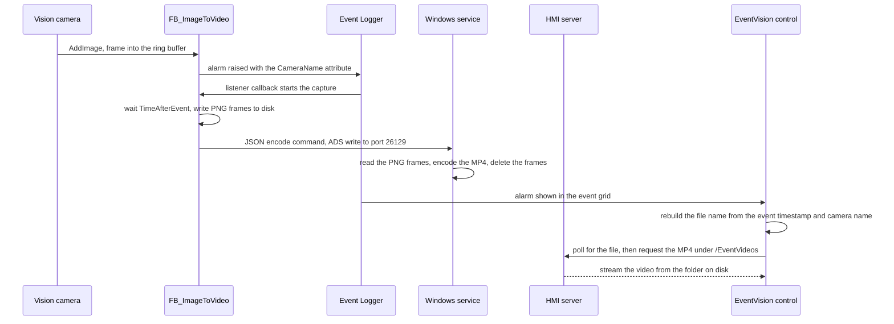

# Architecture

Event Video Playback is three components that share one folder on disk and one ADS conversation. The PLC library records, the Windows service encodes, and the HMI control plays back. ADS (Automation Device Specification) is the TwinCAT messaging protocol: every runtime and tool on a TwinCAT system reaches the others through the ADS router, and the Windows service joins that network as its own ADS server on port 26129.

The three components install differently, and it helps to know which piece lands where:

* The PLC library installs through the XAE workload. XAE is the TwinCAT engineering environment. The workload places the library in the library repository so you can reference it from a PLC project.
* The Windows service installs through the XAR workload. XAR is the TwinCAT runtime. The workload installs the service on the machine that runs the PLC and has access to the video folder.
* The HMI control is a framework control, delivered as a NuGet package that you install into the HMI project in the engineering environment. It ships to the browser with the published HMI project. Nothing extra runs on the HMI server; playback only needs a virtual directory, described below.

See [Installation](./installation.md) for the feed setup and the exact package names.

## Data flow



## PLC library

`FB_ImageToVideo` extends `FB_ListenerBase2`, the listener base class of the TwinCAT EventLogger. The EventLogger is the central alarm and message broker of a TwinCAT system; a listener receives a callback for every event that matches its filter. Full reference: [PLC Library](./plc-library.md).

The block has three jobs:

* **Buffer.** Call `AddImage` for every new camera frame. The frame is scaled by `ReductionFactor` (default 0.25), the scaled result is trimmed to even pixel dimensions because the video encoder rejects odd sizes, and the frame is stored in a ring buffer that lives in router memory. At a `ReductionFactor` of 1 the frame is copied as is, so full size cameras must deliver even dimensions themselves. Router memory is the shared memory pool of the ADS router, sized in the real time settings of the project.
* **Trigger.** The block subscribes to EventLogger events whose JSON attribute matches `{CreateVid: 1, CameraName: "<CameraName>"}`. Raise any event with that attribute, or call `TriggerAlarmForVideoCapture`, which raises the library's own capture alarm with that attribute already attached.
* **Capture.** On the alarm callback the block waits `TimeAfterEvent` so the frames after the event land in the buffer, then writes every buffered frame to disk as a PNG, oldest first, and sends the encode command to the service. The buffer holds `TimeBeforeEvent` plus `TimeAfterEvent` of footage at `FramesPerSecond`. The example in [Getting Started](./getting-started.md) records three seconds before and three seconds after the event at 10 frames per second, which needs 60 frames.

If a frame repeatedly fails to write, the block abandons the capture after 10 consecutive failed attempts (`MAX_IMAGE_WRITE_RETRIES`) and reports `ErrorID` 16#AEE00001. Without that cap a full disk would silently freeze all further capture.

The library defines one event class with four entries. Every instance uses the same entries; the actual camera name travels in the alarm text and its JSON attribute.

|**Event**|**Severity**|**Raised when**|
|--|--|--|
|Camera1Alarm|Error|A capture was triggered. This is the alarm the video belongs to|
|ImageToVideoService|Info|An ADS write to the Windows service failed, either the heartbeat or the encode command|
|RouterMemoryTooSmall|Critical|The configured buffer needs more router memory than the budget allows|
|VideoConfigTooLongForBufferSize|Info|The time window needs more frames than `MAX_NUMBER_IMAGES_2_VIDEO`|

### ADS contract, PLC side

The PLC talks to the service on the port set by `Parameters_EventVideoPlayback.ADS_PORT_FOR_IMAGE_TO_VIDEO`, 26129 by default. Two writes exist:

* **Heartbeat.** One byte to index group 10, offset 10. The payload is ignored; a successful reply means the service is reachable. The block sends it once during initialization and then every five seconds while the ImageToVideoService alarm is active, clearing the alarm when a write succeeds.
* **Video command.** A JSON document to index group 1, offset 1, sent after the frames are on disk:

```json
{
  "ImagePathSource": "C:\\TcAlarmVideo\\Camera1\\Images",
  "VideoFilename": "C:\\TcAlarmVideo\\Camera1\\2026-08-07-14-30-05.mp4",
  "VideoFPS": 10
}
```

The video file name is the event timestamp converted to the local time zone of the target, so the HMI can rebuild it later from the event alone.

## Windows service

The service is a .NET Windows service that runs on the same machine as the PLC runtime. It registers as an ADS server under the port from its configuration file, 26129 by default, which must match the PLC parameter. Settings and defaults are covered in [Service Configuration](./service-configuration.md).

Since the 2.1.0 release the configuration file is read from the install directory, and any missing or invalid value falls back to its documented default one field at a time. Earlier versions read the file relative to the working directory, which for a Windows service is System32, so they usually ran on the fallback defaults without anyone noticing.

Incoming writes are handled by index group:

|**Operation**|**Index group**|**Reply**|
|--|--|--|
|Heartbeat|10|Success, payload ignored|
|Video command|any other value|Success means the job was queued, not that the video exists yet. Malformed JSON returns DeviceInvalidData, missing fields or a rejected path return ClientInvalidParameter, and a full queue returns DeviceBusy|

Encode jobs run one at a time from a queue that holds eight entries, so two cameras firing at once cannot race on the output folder. Each job reads the PNG files sorted by name, takes the frame size from the first image, writes the MP4 with OpenCV using the configured codec (H.264 as `avc1` by default), and then deletes the image folder. A failed encode keeps the images and removes the partial video file instead.

After every encode the service maintains the video folder of that camera: files older than `VideoDeleteTime` days are deleted, and if the folder is still larger than `MaxFolderSize` MB the single oldest video is removed. The next encode triggers the next pass, so an oversized folder shrinks gradually rather than in one sweep.

!!! warning
    The image folder is deleted recursively after a successful encode. Since the 2.1.0 release the `VideoRootDirectory` setting confines every path the PLC sends to one directory tree and rejects anything outside it, including UNC paths. Set it to your video root in production so a misconfigured PLC cannot point the delete anywhere else.

## HMI control

`EventVision` is a framework control that extends the stock `TcHmiEventGrid`, the standard TwinCAT HMI alarm grid. It replaces the details popup of the grid with one that carries a video button. Full reference: [HMI Control](./hmi-control.md).

When you open the details of an alarm, the control:

1. Reads the camera name from the JSON attribute of the event. Events without a `CameraName` attribute get no video button.
2. Rebuilds the video file name from the event timestamp, converted to the time zone of the target with the structure bound to the `TimeZone` property.
3. Polls the HMI server for that file, up to `VideoCheckRetries` attempts (default 60) spaced `VideoCheckDelay` milliseconds apart (default 100). The button reads WAITING FOR VIDEO while polling, PLAY VIDEO once the file exists, and VIDEO UNAVAILABLE when the retries run out. The wait exists because the service needs a moment to encode after the alarm appears.
4. Plays the file in a modal dialog. The browser streams it over HTTP from the HMI server through a virtual directory, a server mapping from a URL path (default `/EventVideos`) to a folder on the target (the video root, `C:\TcAlarmVideo` by default). The Windows service takes no part in playback.

!!! note
    The alarm does not carry the file name itself. The control derives it from the event timestamp and camera name, which is why the `TimeZone` property must be bound to the time zone structure of the target. Without it the control falls back to the browser's local time, which only matches when browser and target sit in the same time zone.

If the stock popup base class cannot be loaded, for example after a Controls package change, the control falls back to the standard details popup without the video button and logs the reason.

## Files and folders

Everything lands under the root set by `VideoOutputDirectory` on the function block, `C:\TcAlarmVideo` by default. Each camera gets a subfolder named after `CameraName`:

* `C:\TcAlarmVideo\Camera1\` holds the videos for that camera, one MP4 per capture, named after the event time in target local time, for example `2026-08-07-14-30-05.mp4`
* `C:\TcAlarmVideo\Camera1\Images\` holds the PNG frames of the capture in progress, `Image0001.png` and upward in recording order. The service deletes this folder after a successful encode

The virtual directory of the HMI server points at the same root, so `/EventVideos/Camera1/2026-08-07-14-30-05.mp4` reaches the file above. Keep the three settings aligned: the PLC `VideoOutputDirectory`, the service `VideoRootDirectory`, and the virtual directory path in the HMI server configuration.

## Limits worth knowing

* **One function block instance per camera.** Each instance owns one camera name, one folder, and one event subscription. All instances share the same four event entries, so every capture alarm is the Camera1Alarm entry regardless of the actual camera; the camera name in the alarm text and attribute tells them apart.
* **One capture at a time per instance.** Alarms that arrive while the frames are being written to disk are dropped and counted in `MissedEventCount`; an alarm that arrives during the encode handoff starts the next capture as soon as the current one finishes. The first capture cannot start until the buffer has filled once after startup.
* **Router memory budget.** The buffer must fit in half of router memory (`MAX_PERCENT_ROUTER_MEM_FOR_BUFFER`). The router reports its size as 0 when it has more than 4 GB or when the read failed; in both cases the check assumes `LARGE_ROUTER_MEMORY`, 4096 MB by default. When the buffer does not fit, the RouterMemoryTooSmall alarm is raised and you shorten the window, lower the frame rate, lower `ReductionFactor`, or add router memory.
* **Frame count cap.** The window times the frame rate is capped by `MAX_NUMBER_IMAGES_2_VIDEO`, 200 frames by default. A longer window raises the VideoConfigTooLongForBufferSize alarm.
* **Encode queue depth.** The service queues at most eight encode jobs and answers DeviceBusy beyond that, which the PLC sees as a failed write.

Source for all three components: [github.com/Beckhoff-USA-Community/EventVideoPlayback](https://github.com/Beckhoff-USA-Community/EventVideoPlayback)
