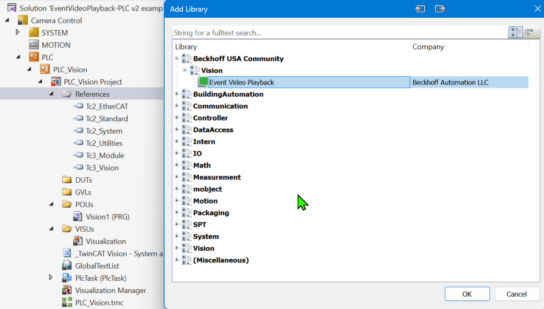
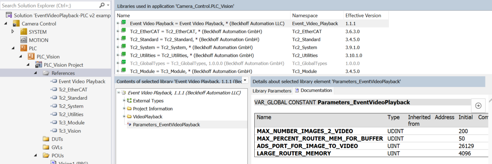
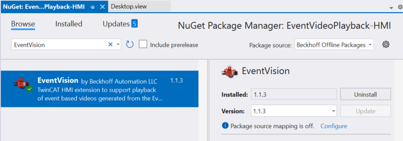
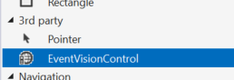
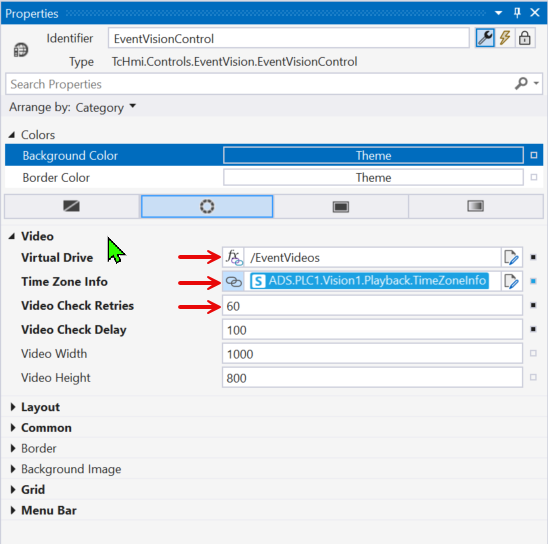

# Getting Started

Event Video Playback records what a camera saw around the moment an alarm fired. Three components work together: a PLC library that keeps camera images in a ring buffer (a fixed size buffer that overwrites its oldest entry when full) and reacts to alarms, a Windows service that encodes the buffered images into an MP4 file, and an HMI control that plays the finished video from the alarm's log entry. [Architecture](./architecture.md) explains how the pieces talk to each other. This guide walks you through wiring all three into a TwinCAT project.

!!! warning
    Videos play only from a published project viewed in a web browser. The HMI Live display in the engineering environment cannot play them.

## The service

The Windows service installs with the XAR workload described in [Installation](./installation.md) and starts automatically. The shipped defaults work for a first project, so you do not need to touch its configuration file to follow this guide. The service reads the file once at startup, so any change requires a service restart; the full parameter reference is in [Service Configuration](./service-configuration.md).

## PLC integration

!!! note
    Install the XAE and XAR packages with the TwinCAT Package Manager first. See [Installation](./installation.md).

`FB_ImageToVideo` keeps its image buffer in router memory, the memory pool TwinCAT reserves for ADS communication and dynamic allocation. The buffer grows with the frame rate, the recorded time window, the camera image size, and the `ReductionFactor`, so size the router memory in the TwinCAT project with the buffer in mind. The [library parameters](#library-parameters) below set the limits the library checks against.

Integrating with an existing TwinCAT Vision project takes six steps.

### 1. Add the library reference

Add the Event Video Playback library to the References section of the PLC project.



### 2. Instantiate FB_ImageToVideo

Declare one instance per camera, along with the booleans your application will use to trigger captures:

```iecst
VAR
    // ImageToVideo instance
    EVP1 : FB_ImageToVideo := (CameraName := 'Camera1',
                               FramesPerSecond := 10,
                               TimeBeforeEvent := T#3S,
                               TimeAfterEvent := T#3S,
                               VideoOutputDirectory := 'C:\TcEventVideos',
                               ReductionFactor := 0.25);

    // Event trigger booleans
    TriggerEvent1 : BOOL;
    TriggerEvent2 : BOOL;
END_VAR
```

The [instance parameters](#instance-parameters) section below describes each value.

### 3. Call Reset on the first scan

`Reset` clears the configuration alarms and the latched error state. Call it once on the first scan of the POU:

```iecst
EVP1.Reset();
```

### 4. Call CyclicLogic every cycle

`CyclicLogic` drives the function block: it initializes the instance, services the event listener, runs the capture state machine, and keeps the memory checks up to date. It must be called every PLC cycle:

```iecst
EVP1.CyclicLogic();
```

### 5. Call AddImage for every new image

Call `AddImage` in the section of your program that receives a new image from the camera. Each call scales the frame by `ReductionFactor` and stores it at the current ring position:

```iecst
EVP1.AddImage(ipImageIn := ImageIn);
```

### 6. Add the trigger logic

`TriggerAlarmForVideoCapture` raises the camera alarm and starts a capture. One call per event is enough. Different log entry names can share the same instance, so several distinct events can produce videos from one camera:

```iecst
IF TriggerEvent1 THEN
    TriggerEvent1 := FALSE;
    EVP1.TriggerAlarmForVideoCapture(LogEntryName := 'Log Entry Name1');
END_IF

IF TriggerEvent2 THEN
    TriggerEvent2 := FALSE;
    EVP1.TriggerAlarmForVideoCapture(LogEntryName := 'Log Entry Name2');
END_IF
```

!!! note
    A trigger is ignored until the ring buffer has filled once, so the first capture cannot start until `TimeBeforeEvent` plus `TimeAfterEvent` has elapsed after startup. A trigger is also ignored while the alarm is already raised.

## Instance parameters

### CameraName

A unique identifier for each `FB_ImageToVideo` instance, for example `Camera1`, `Infeed_Camera`, or `Arm_Camera`. The name selects the output subfolder and tags the alarm, so it must be unique across all instances.

### FramesPerSecond

The rate at which images are added to the ring buffer, as an integer. The setter clamps values below 1 to 1 because the video length calculation divides by this value.

### TimeBeforeEvent and TimeAfterEvent

`TIME` values, for example `T#3S`. Together they set the total video length: footage from `TimeBeforeEvent` before the alarm through `TimeAfterEvent` after it. The defaults are 7 seconds before and 3 seconds after.

### VideoOutputDirectory

The storage location for images and videos. Videos are saved in a subfolder named after the camera, so with `C:\TcEventVideos` and `Camera1` the files land in `C:\TcEventVideos\Camera1\`. The Windows service must be able to reach this path, since the service does the encoding.

### ReductionFactor

Scales each frame before it enters the buffer to cut memory use. The factor applies to both width and height, so the memory per frame shrinks with the square of the value: `0.25` keeps a quarter of each dimension, which is about 6 percent of the original pixels. Valid values are greater than 0 and at most 1. The setter replaces values of 0 or below with the default 0.25 and clamps values above 1 to 1.

## Library parameters

These parameters apply to the library as a whole, not to a single instance. Select the EventVideoPlayback library under References to edit them. The library reads the router memory size during initialization and checks on every cycle whether the configured buffer fits in the allowed share; if it does not, the library raises an alarm and video capture does not run.



### MAX_NUMBER_IMAGES_2_VIDEO

The number of frames the ring buffer can hold. The default is 200. The buffer must hold at least `FramesPerSecond * (TimeBeforeEvent + TimeAfterEvent)` frames with the times in seconds; add a frame or two of headroom. For 10 frames per second and a 6 second window that is 60 frames, so 62 leaves margin. If the configured window needs more frames than the buffer holds, the library raises an alarm and shortens nothing silently.

### MAX_PERCENT_ROUTER_MEM_FOR_BUFFER

The share of router memory one `FB_ImageToVideo` instance may occupy, in percent. The default is 50. The limit applies per instance, so divide your total budget by the instance count:

* One instance: a value of `60` lets it use up to 60 percent of router memory.
* Three instances sharing a 60 percent budget: set `20`, so all three combined stay at or below 60 percent.

### ADS_PORT_FOR_IMAGE_TO_VIDEO

!!! danger
    Do not change this value. This is the ADS port the Windows service listens on, and the service configuration file pins the same number, 26129. The PLC sends its encode commands to this port, so changing one side without the other breaks the connection.

### LARGE_ROUTER_MEMORY

The router memory size in MB that the library assumes when the actual value cannot be read. The status read reports 0 in two cases: the router has more memory than the field can express, which is anything above 4095 MB, or the read itself failed. In either case the library uses this parameter, default 4096, for its memory check. If your target has more router memory than 4095 MB, set the parameter to the real size so the check does not underestimate what is available.

## HMI integration

### Add the EventVision NuGet package

1. Open the NuGet Package Manager in your HMI project.
2. Go to the Browse tab.
3. Search for the EventVision package and install it.



!!! tip
    If the package does not appear, verify that the package source is set to Beckhoff Offline Packages.

### Add the control

Once the package is installed, add the EventVisionControl to a page from the Toolbox.



### Set the properties

After adding the control, set its properties:



!!! warning
    The virtual directory setting on the control must match the virtual directory configured on the HMI server, otherwise the control cannot reach the video files. The time zone setting is required when the browser viewing the HMI runs in a different time zone than the TwinCAT HMI server, otherwise timestamps will not line up with the log entries.

The full attribute reference and the virtual directory and publish configuration setup are in [HMI Control](./hmi-control.md).

## Next steps

With all three components wired up you can:

* Trigger a test event from your PLC code and confirm a video file appears under the output directory.
* Publish the HMI project and play the video from the alarm's details popup in a browser.
* Tune the service settings, see [Service Configuration](./service-configuration.md).
* Add more cameras by declaring more `FB_ImageToVideo` instances, one per camera.

## Support

* [GitHub Issues](https://github.com/Beckhoff-USA-Community/EventVideoPlayback/issues) to report bugs or request features.
* [Beckhoff USA Community](https://github.com/Beckhoff-USA-Community) for the other community projects and discussions.
