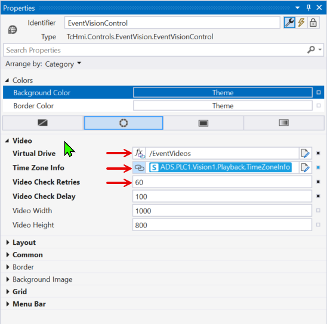
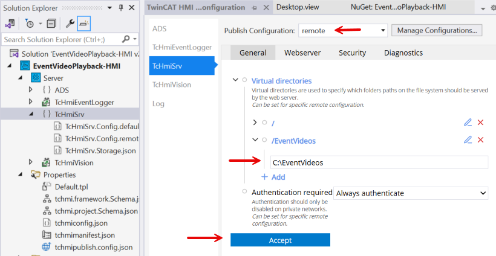
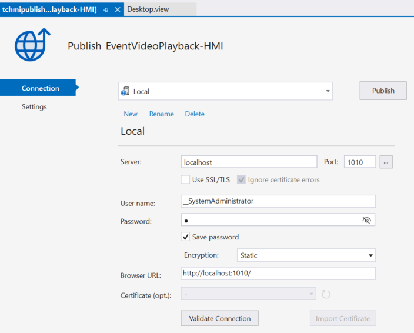
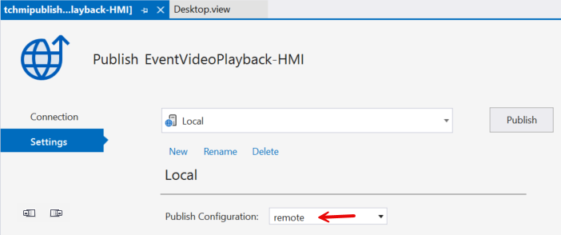

# HMI Control

EventVision is a TwinCAT HMI framework control that subclasses `TcHmiEventGrid`, the stock event grid from the Beckhoff Controls package. Everything the stock grid does, EventVision does the same way: listing, filtering, sorting, and confirming events from the TwinCAT EventLogger. The addition is video playback. When you open the details popup of an alarm raised by the [PLC library](./plc-library.md), the popup gains a video button that plays the clip the [service](./service-configuration.md) encoded for that alarm.

Adding the control to a project is covered in [Getting Started](./getting-started.md). This page is the reference for the control itself: its package requirements, its attributes, how playback behaves, and the server configuration it depends on.

## Requirements

The EventVision package declares three minimum dependencies, so the NuGet package manager enforces them at install time:

* `Beckhoff.TwinCAT.HMI.Framework` version 14.5.1 or newer
* `Beckhoff.TwinCAT.HMI.Controls` version 14.7.1 or newer
* `Beckhoff.TwinCAT.HMI.EventLogger` version 23.0.275 or newer

The Controls floor is the important one. Since the 14.6 line of the Controls package the event grid's details popup ships as an ES module, the native JavaScript module format, inside the Controls package. EventVision imports that module at runtime and extends it to build the video popup, so a Controls package older than the 14.6 line has nothing to import. The EventLogger extension supplies the events the grid displays.

The exact package combinations each release was tested against are listed in the [package README](https://github.com/Beckhoff-USA-Community/EventVideoPlayback/blob/main/packaging/packages/EventVision.HMI/docs/README.md).

!!! note
    Since EventVision 1.2.0 the details popup is rebuilt for the current TE2000 packages. The 1.1.x releases that shipped with the 2.0.x train predate the ES module popups and do not work on the 14.6 Controls line or newer.

## Attributes

The control adds six attributes to the stock event grid set. They appear in the Properties pane under the Video category.

|**Attribute**|**Type**|**Default**|**Description**|
|--|--|--|--|
|Virtual Drive (`data-tchmi-virtual-drive`)|String|`/EventVideos`|The directory that holds the video files|
|Time Zone Info (`data-tchmi-timezone-info`)|TimeZoneInfo|null|Timezone info used for Timezone conversion|
|Video Check Retries (`data-tchmi-video-check-retries`)|Number|60|The number of retries to check if the video exists|
|Video Check Delay (`data-tchmi-video-check-delay`)|Number|100|The time in milliseconds between retries to check if the video exists|
|Video Width (`data-tchmi-video-width`)|Number|1000|The default width of the video player|
|Video Height (`data-tchmi-video-height`)|Number|800|The default height of the video player|

Notes on the individual attributes:

* **Virtual Drive** must match the name of the virtual directory you publish on the HMI server. The control builds every file request from this value, so a mismatch means no video ever plays. See [Virtual directory and publish configuration](#virtual-directory-and-publish-configuration) for the why.
* **Time Zone Info** is a `TcHmi.Controls.EventVision.TimeZoneInfo` structure modeled on the Windows TIME_ZONE_INFORMATION structure: a base bias in minutes, standard and daylight bias values, and the transition rules between them. Bind it whenever a viewing browser can sit in a different time zone than the HMI server. The [Behavior](#behavior) section explains what the control does with it.
* **Video Check Retries** and **Video Check Delay** control how long the popup waits for the video file to appear. At the defaults the control checks 60 times, 100 milliseconds apart, so it gives up after roughly six seconds. Raise the retries if your `TimeAfterEvent` is long, since the file cannot exist before that time has passed.
* **Video Width** and **Video Height** size the playback dialog in pixels.

## Behavior

Playback works end to end like this:

1. The PLC library raises the alarm through the TwinCAT EventLogger. The alarm's JSON attribute carries the camera name, and the alarm's raise time determines the video file name, since the service names each file after the event timestamp.
2. You open the alarm's details popup in the grid. The popup honors the stock AllowDetailsPopup attribute, and the video button sits at the left edge of the popup footer while the stock confirm and close buttons keep their right alignment.
3. The button starts disabled as WAITING FOR VIDEO while the control polls the virtual directory for the file.
4. When the file appears the button changes to PLAY VIDEO. Pressing it opens a dialog that plays the clip.
5. When the retries run out the button changes to VIDEO UNAVAILABLE.

Polling exists because of a timing gap: the alarm appears in the grid the moment the event is raised, but the video cannot exist yet. The library keeps buffering images for the configured `TimeAfterEvent`, then the service encodes them, so the file lands on disk a few seconds after the alarm. The popup polls through that gap instead of assuming the file is there.

Details worth knowing:

* The poll asks the HMI server to list the files in `<Virtual Drive>/<CameraName>`. A server side error, such as a missing virtual directory, counts as a failed attempt, so a misconfigured server ends in VIDEO UNAVAILABLE instead of polling forever. An unexpected failure during the check is written to the framework log (visible in the browser console) and also ends in VIDEO UNAVAILABLE.
* Alarms raised without a camera name in their JSON attribute get no video button. The rest of the popup behaves like the stock grid.
* Selecting a different alarm while the popup is open restarts the check for the new alarm and cancels the old poll, so a late result cannot enable the button for the wrong alarm.
* The video plays muted. Browsers block unmuted autoplay, and the service encodes no audio track anyway.
* Closing the playback dialog stops the video rather than hiding it, and closing the details popup cancels any running poll.
* The video file name is the alarm's raise time expressed in the HMI server's local time. With Time Zone Info bound, the control converts the timestamp using the base bias plus the daylight or standard bias and the Windows transition rules, so daylight saving time is handled. Without it, the control falls back to the browser's local time, which only lines up when the browser and the server share a time zone. This is why Time Zone Info matters for remote viewing: a browser one time zone away computes a file name that does not exist, and the button ends at VIDEO UNAVAILABLE.
* The button texts (PLAY VIDEO, WAITING FOR VIDEO, VIDEO UNAVAILABLE) and the dialog title are localized in English and German. The button texts follow a locale switch at runtime; the dialog title is applied each time the dialog opens.
* If the video popup cannot be built, for example because the Controls popup module fails to load, the control logs a warning and falls back to the stock details popup without the video button. The grid itself keeps working.
* Once per page load the control logs its own version together with the loaded Framework and Controls package versions, which is useful when reporting an issue after a TwinCAT HMI update.

## Virtual directory and publish configuration

The HMI server does not serve arbitrary disk paths to the browser. To make the video files reachable, publish the video storage folder as a virtual directory in TcHmiSrv, the TwinCAT HMI server. A virtual directory maps a URL path to a folder on the server machine.

1. In the Solution Explorer, open **Server**, then **TcHmiSrv**.
2. Add a virtual directory that points at the video storage location, the folder you set as `VideoOutputDirectory` on `FB_ImageToVideo`. Point it at the root storage folder, not at a camera subfolder. The control appends the camera name itself.

The virtual directory name must match the control's Virtual Drive attribute. The control builds the poll request as a file listing of `<Virtual Drive>/<CameraName>` and the playback URL as `<Virtual Drive>/<CameraName>/<timestamp>.mp4`. If the server publishes the folder under a different name, the directory listing and the video request both miss, and the button ends at VIDEO UNAVAILABLE even though the file is on disk.

!!! warning
    The TcHmiSrv page edits one publish configuration at a time. If you deploy with a Remote publish configuration, select that configuration in the dropdown at the top of the TcHmiSrv page before adding the virtual directory. A virtual directory added only to the Local configuration does not travel to the remote server, and the published HMI polls an empty path.

!!! note
    Videos play from a published project viewed in a web browser. They do not play in the Live display inside the engineering environment.
