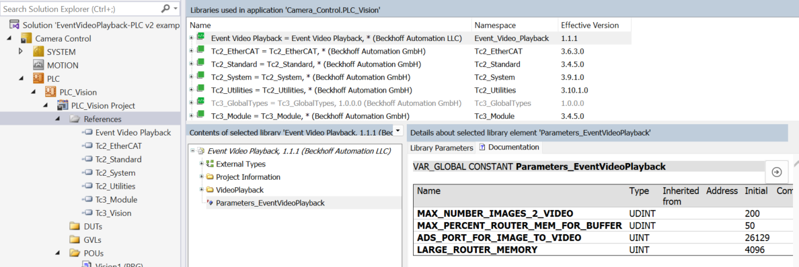

# PLC Library

The PLC library provides the recording side of Event Video Playback. `FB_ImageToVideo` keeps a rolling ring buffer of TwinCAT Vision images in router memory, the memory pool the TwinCAT router allocates for ADS communication (ADS, Automation Device Specification, is the protocol TwinCAT components use to exchange data). When a subscribed alarm fires, the block writes the buffered frames to disk as PNG files and sends the Windows service an encode command over ADS. One `FB_ImageToVideo` instance serves one camera, so declare one instance per camera, each with its own `CameraName`. Wiring the block into a project is shown step by step in [Getting Started](./getting-started.md).

## FB_ImageToVideo

Ring buffer, event listener and capture state machine in one function block. It subscribes to the TwinCAT EventLogger, the central event and alarm system of the runtime, and starts a capture when a matching alarm is raised.

!!! note
    `FB_ImageToVideo` extends `FB_ListenerBase2` from the Tc3_EventLogger library. Inherited listener members are not listed here.

### Properties

The configuration properties are write only (access W); the block does not expose getters for them.

|**Property**|**Type**|**Access**|**Description**|
|--|--|--|--|
|Busy|BOOL|R|TRUE while a video capture is in progress, from the alarm until the encode request has been sent|
|CameraName|STRING|W|Name of the camera this instance records. Forms part of the output path and identifies the alarm. Set it before the first `CyclicLogic` call. Defaults to `Camera1`|
|Error|BOOL|R|TRUE when the block has latched an error. Read `ErrorID` for the cause and call `Reset` to clear. The two configuration alarms also set this without an `ErrorID`, so read `IsTooLongForBufferFPS` and `IsImageBufferOrRouterMemoryTooSmall` to tell them apart|
|ErrorID|UDINT|R|Code of the most recent failure: an ADS result from the service write, the image write failure code, or the error of the time zone or router memory read during start up. The router memory code is recorded without setting `Error` because that failure is not fatal|
|FramesPerSecond|UINT|W|Frame rate of the recorded video, and the rate at which `AddImage` is expected to be called. Also sizes the ring buffer together with the time window. Clamped to at least 1. Defaults to 10|
|InitComplete|BOOL|R|TRUE once the start up sequence has finished and the block is recording|
|IsImageBufferOrRouterMemoryTooSmall|BOOL|R|TRUE when the configured buffer needs more router memory than is available. Raises the RouterMemoryTooSmall alarm. Reduce the time window, frame rate or reduction factor, or increase router memory|
|IsTooLongForBufferFPS|BOOL|R|TRUE when the configured time window needs more frames than the buffer can hold. Raises the VideoConfigTooLongForBufferSize alarm. Shorten the window or raise `MAX_NUMBER_IMAGES_2_VIDEO`|
|JsonAttribute|T_MaxString|W|JSON attribute used to filter subscribed events. `Initialize` always rebuilds this from `CameraName`, so a value written before the first `CyclicLogic` call is replaced. Write it after initialization, then set `UnsubscribeEvents` and `SubscribeEvents` so the next `CyclicLogic` call resubscribes with the new filter|
|ReductionFactor|LREAL|W|Scale applied to each frame before buffering, which trades video resolution for memory. Values above 1 are limited to 1 and values of 0 or below are replaced with the 0.25 default. 1 keeps full size|
|SubscribedEvents|BOOL|R|TRUE while the block is subscribed to the EventLogger|
|SubscribeEvents|BOOL|W|Set TRUE to subscribe to matching events. The subscription is made on the next `CyclicLogic` call|
|TimeAfterEvent|TIME|W|How much footage to keep after the alarm. Added to `TimeBeforeEvent` to size the buffer. Defaults to 3 seconds|
|TimeBeforeEvent|TIME|W|How much footage to keep before the alarm. Added to `TimeAfterEvent` to size the buffer. Defaults to 7 seconds|
|UnsubscribeEvents|BOOL|W|Set TRUE to unsubscribe from events. The unsubscribe happens on the next `CyclicLogic` call|
|VideoOutputDirectory|STRING|W|Root directory for images and videos, which the Windows service must also be able to reach. Videos are written to the `CameraName` subfolder. Read each time a capture builds its paths, so a change takes effect on the next capture. Defaults to `C:\TcAlarmVideo`|

### Methods

|**Method**|**Return Type**|**Access**|**Description**|
|--|--|--|--|
|AddImage|-|PUBLIC|Adds one camera frame to the ring buffer. Call it every scan that produces a new image. The frame is scaled by `ReductionFactor`, with odd pixel dimensions trimmed because the video encoder requires even sizes, and stored at the current ring position. Frames are ignored while a capture is writing images to disk and while the block is in an error state|
|CyclicLogic|-|PUBLIC|Drives the function block and must be called once per PLC scan. Runs `Initialize` on the first scans, services the event listener, executes the capture state machine, keeps the buffer size and router memory checks up to date, and retries the service connection while the ImageToVideoService alarm is raised|
|Initialize|BOOL|PUBLIC|One time start up sequence, called by `CyclicLogic` until it returns TRUE. Reads the local time zone, reads router memory, creates the four alarms, then writes once to the Windows service to confirm it is reachable. A time zone failure sets `Error` and `ErrorID`; a router memory failure records `ErrorID` only, without setting `Error`. Start up continues on documented fallbacks in both cases|
|OnAlarmRaised|HRESULT|PUBLIC|Listener callback, called by the EventLogger when a subscribed alarm is raised. Latches a capture request for the next `CyclicLogic` scan and copies the event timestamp by value|
|Reset|-|PUBLIC|Clears the configuration alarms, the camera alarm and the latched error state. Use it after correcting a configuration or after the video service has been restored. Does not interrupt a capture that is already running|
|TriggerAlarmForVideoCapture|-|PUBLIC|Raises the camera alarm from PLC code, which starts a video capture. `LogEntryName` is shown in the alarm text and identifies what happened. Ignored while the alarm is already raised or before the ring buffer has filled once|
|WriteImage|BOOL|PUBLIC|Writes one buffered frame to disk as a PNG, named `Image0001.png` and upward. Called repeatedly by the capture state machine. Returns TRUE when the frame has been written, FALSE while the write is still in progress or after it failed|

### Notes

* Call `CyclicLogic()` every PLC cycle. It runs the start up sequence, services the listener and drives the capture state machine, so nothing in the block works without it.
* Call `Reset()` once on the first PLC scan and again after a latched error once the cause is corrected. It clears the configuration alarms, the camera alarm and the latched error state without interrupting a running capture.
* Call `AddImage()` for every new camera frame. The block expects frames at the `FramesPerSecond` rate, and the buffer only covers the configured time window when the two rates match. An alarm is ignored until the buffer has filled once, so the first capture cannot start until `TimeBeforeEvent` plus `TimeAfterEvent` has elapsed after start up.
* A frame that cannot be written to disk is retried. After `MAX_IMAGE_WRITE_RETRIES` consecutive failed attempts the block abandons the capture, sets `Error` and latches `ERROR_IMAGE_WRITE_FAILED` in `ErrorID`. Correct the storage problem, then call `Reset()`. The built in service heartbeat clears the service connection error only, because a reachable service says nothing about the disk, so it never clears an image write failure.
* Path and JSON strings are `T_MaxString` variables, a 255 character string type. Keep `VideoOutputDirectory` short enough that the directory, camera name, timestamp and file extension fit in 255 characters, and that the JSON command carrying both paths does too.

## Library parameters

The `Parameters_EventVideoPlayback` global variable list is declared as a parameter list, so you can change the values on the library reference in your project without editing the library. Double click the References node of the PLC project, select the library and edit the values on the Library Parameters tab.

|**Parameter**|**Type**|**Default**|**Description**|
|--|--|--|--|
|MAX_NUMBER_IMAGES_2_VIDEO|UDINT|200|Frames the ring buffer can hold. Sets the upper bound on `TimeBeforeEvent` plus `TimeAfterEvent` at a given `FramesPerSecond`, and on the router memory the buffer needs|
|MAX_PERCENT_ROUTER_MEM_FOR_BUFFER|UDINT|50|Share of router memory the image buffer is allowed to occupy, in percent|
|ADS_PORT_FOR_IMAGE_TO_VIDEO|UINT|26129|AMS port of the Event Video Playback Windows service. Must match the AdsPort value in the [service configuration](./service-configuration.md) file|
|LARGE_ROUTER_MEMORY|UINT|4096|Router memory in MB assumed whenever the reported value is 0, which happens both when the router has more memory than it can report and when the read itself failed|
|MAX_IMAGE_WRITE_RETRIES|UINT|10|Consecutive failed attempts to write one frame before the capture is abandoned. Counts attempts, not PLC scans, since one attempt spans the scans the file write is busy|
|ERROR_IMAGE_WRITE_FAILED|UDINT|16#AEE00001|`ErrorID` reported when a capture is abandoned because frames could not be written to disk. Clear it with `Reset` once the storage problem is corrected. Bit 29 is set so the value sits in the customer defined HRESULT range and cannot collide with an ADS result code|

## Events

The library raises its TwinCAT events from its own event class, `VideoAlarm` (display name Event Video Playback). `Initialize` creates all four as alarms. They appear in the EventLogger like any alarm from your own code, which means they also show up in the HMI event grid and in the [EventVision control](./hmi-control.md).

|**Event**|**Id**|**Severity**|**Display text**|
|--|--|--|--|
|Camera1Alarm|1|Error|`{0} - {1}`|
|ImageToVideoService|2|Info|Image To Video Service Not Running|
|RouterMemoryTooSmall|3|Critical|Router Memory Too Small|
|VideoConfigTooLongForBufferSize|4|Info|Video Configuration Too Long For Image Buffer Size|

Camera1Alarm is the alarm that carries the video. Its two placeholders are the log entry name passed to `TriggerAlarmForVideoCapture` and the camera name. Every instance uses the same Camera1Alarm event entry, so with several cameras the camera name argument is what tells the alarms apart. ImageToVideoService is raised while the Windows service cannot be reached and clears on its own once the service answers again. The two configuration events mirror the `IsTooLongForBufferFPS` and `IsImageBufferOrRouterMemoryTooSmall` properties and carry cause and remedy texts in the event entry.

## Version functions

Three functions created from the project information report the library identity at runtime. Use them when you need to confirm which library version a target actually runs.

|**Function**|**Return Type**|**Description**|
|--|--|--|
|F_GetCompany|WSTRING|Returns the vendor name, Beckhoff Automation LLC|
|F_GetTitle|WSTRING|Returns the library title, Event Video Playback|
|F_GetVersion|ST_LibVersion|Returns the version of the installed library as a structure with major, minor, build and revision numbers plus the version string|
